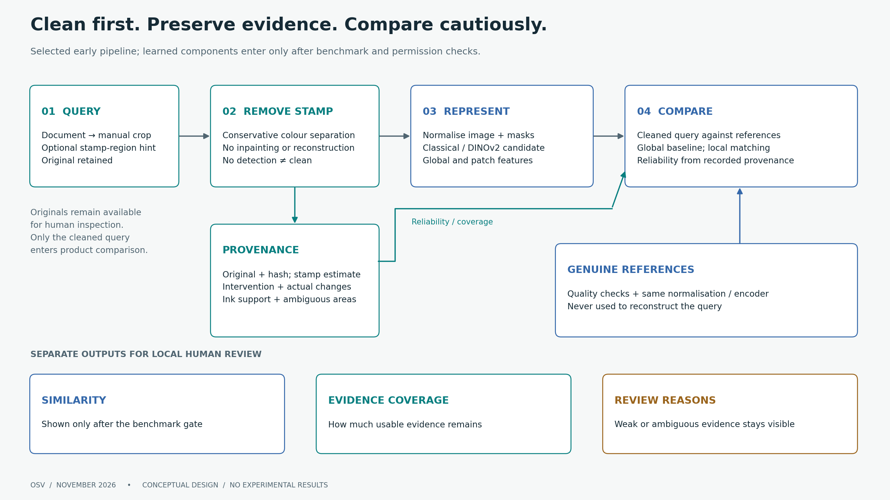
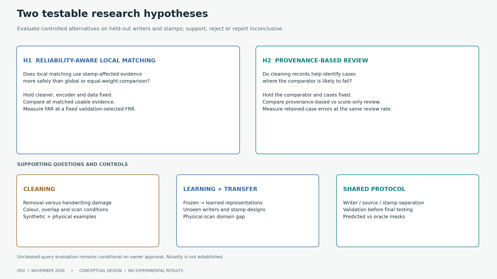
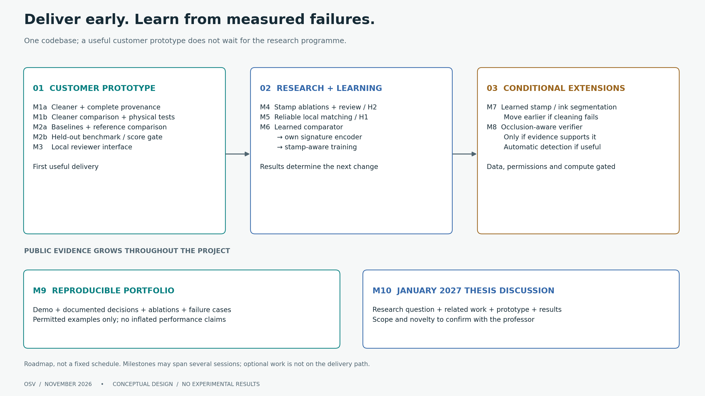
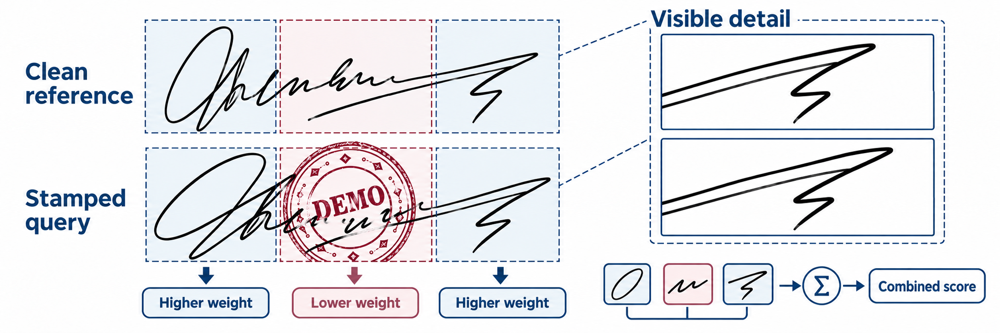
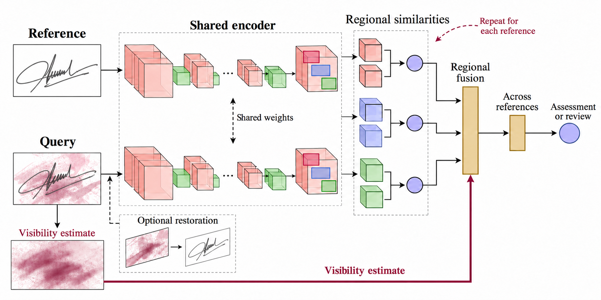

# Occlusion-Aware Signature Verification

A local document-review and deep-learning research project for handwritten signatures obscured by stamps.

**Status — 11 November 2026:** two research reviews and a full build roadmap are complete. The first implementation milestone is in progress; no completed software milestone, trained model, verification accuracy or runtime result is claimed in this update.

[Build roadmap](BUILD_PLAN.md) · [Latest research review](docs/research/SECOND_REVIEW.md) · [Development record](docs/SESSION_LOG.md) · [Literature matrix](literature/literature_matrix.csv)

## The problem

A reviewer needs to compare a stamped signature with genuine references of a claimed writer. Stamp ink can obscure distinguishing strokes, while removing it can also damage handwriting. The project asks whether recorded cleaning interventions and reliable local evidence can improve comparison and identify cases that need human review.

The first goal is a useful local reviewer prototype. The research track then tests reliability-aware matching, review policies and learned signature representations. A possible thesis scope will be discussed in January 2027; novelty and thesis approval are not established.

## Current approach



*Current design, not a measured result. References never reconstruct the query; the original remains available for human inspection.*

- **Cleaning first:** every product query passes through stamp removal before comparison. Preserve the original, stamp estimate, intervention/change maps and ambiguous areas. Do not reconstruct handwriting from genuine references.
- **Honest limitations:** the initial cleaner uses colour separation without inpainting. Deletion can still damage strokes. Black and same-colour stamps may be undetectable; “no stamp detected” does not mean the image is clean.
- **Comparison is a hypothesis:** DINOv2 global/patch features are a candidate baseline, not a proven signature verifier. Fixed-window scoring with a whole-signature encoder is no longer selected. Published SigNet weights remain a permission-dependent research reference.
- **Evidence before scores:** similarity, coverage and review reasons stay separate. Showing an identity-comparison score depends on a benchmark gate against a classical baseline, including skilled forgeries where permitted data are available. An uncalibrated score is not an authenticity probability or verdict.
- **Local customer data:** real documents, signatures and identifying artifacts stay on the reviewer's machine. Public examples use fictional or otherwise permitted material.

The [second review](docs/research/SECOND_REVIEW.md) records sources, alternatives, permission questions and corrections to the [initial review](docs/research/INITIAL_REVIEW.md). Its findings are planning evidence, not measured results from this project.

## Current research questions

**Main question:** How should stamp-affected evidence be treated so that offline signature comparison remains useful without hiding uncertainty or increasing false acceptance?

| Question | Controlled test | Evidence to report |
|---|---|---|
| **RQ1 / H1 — Reliable local evidence:** does reliability-aware local matching outperform global comparison of the cleaned query and equal-weight local matching? | Keep the cleaner, encoder and cases fixed; compare at matched usable evidence | False acceptance at a fixed validation-selected false-rejection rate, with writer-level uncertainty |
| **RQ2 / H2 — Review from provenance:** do cleaning records help identify comparison failures better than a score-only review rule? | Keep the comparator and cases fixed; compare at the same review rate | Errors on retained cases, coverage–error curves and failure examples |
| **RQ3 — Cleaning damage:** which removal strategy best reduces stamp interference while preserving identity-bearing strokes? | Compare cleaners on the same inputs with a fixed verifier; include different/same-colour inks and physical scans | Stamp removal, handwriting loss, downstream verification and missed failure flags |
| **RQ4 — Learning and transfer:** when do a learned comparator, signature-domain encoder and stamp-aware training improve over frozen generic features? | Add one learning step at a time; hold out writers and stamp designs; assess physical-scan transfer | Genuine, random-impostor and skilled-forgery results separately, where permitted labels exist |
| **RQ5 — Practical value:** which improvements justify their data, compute and reviewer-workflow costs? | Compare error, review workload, latency and memory under stated conditions | Measured tradeoffs and local reviewer feedback, not architecture size alone |



H1 and H2 are adaptations to test; novelty and benefit are not established. Oracle masks are evaluation controls, never inference inputs. The uncleaned-query evaluation control remains pending owner approval. Genuine-only data cannot establish skilled-forgery rejection.

## Delivery and research stages

| Stage | Intended result | State |
|---|---|---|
| M1a–M1b: cleaning | Tested command, provenance artifacts, failure examples and cleaner comparison | M1a in progress; completion not yet verified |
| M2a–M2b: comparison | Reference enrolment, baselines, coverage and held-out benchmark | Planned |
| M3: local prototype | Crop, inspect, compare and export cases locally; score only if its gate passes | Planned |
| M4–M5: research evaluation | Stamp ablations, review calibration and reliability-aware local matching | Planned |
| M6: deep learning | Small learned comparator, own signature encoder, then stamp-aware training | Planned; data quality and compute to verify |
| M7–M8: conditional extensions | Learned segmentation and an occlusion-aware verifier where evidence justifies them | Optional; segmentation moves earlier if needed |
| M9–M10: evidence and thesis preparation | Reproducible portfolio demo, results and January discussion pack | Planned; documentation grows with each milestone |



**Research hypotheses, not findings:** reliability-aware local matching improves verification at matched usable evidence; cleaning provenance improves review decisions over a score-only rule. Negative and inconclusive results will be retained.

For coding, [BUILD_PLAN.md](BUILD_PLAN.md) is the single source of truth and [CLAUDE.md](CLAUDE.md) gives concise instructions. Each session implements one bounded task and records actual checks. Runnable commands and measured results will be published when verified.

## Illustrated research background

The following material preserves the earlier proposal and its figures. It describes historical architecture candidates and broader experiments, including learned restoration and fixed regional layouts. Those choices are superseded where they differ from the current approach above and the living build plan. They are not implemented features or required additions.

[Original English proposal](proposal/proposal_v1.2_EN.pdf) · [Slovenian proposal](proposal/proposal_v1.2_SL.pdf)

<details>
<summary>Read the illustrated proposal, research context and references</summary>

## Abstract

This project develops verification of handwritten signatures partly obscured by stamps. Every query passes through stamp removal before comparison with genuine references. The main question is whether weighting regional comparisons by evidence less affected by the original stamp and cleaning improves genuine-signature recognition while retaining rejection of forgeries. Cleaned whole-image scoring and ordinary regional averaging provide controlled comparisons. Selected CNN and CNN–transformer candidates examine the value of greater complexity, while matched training examines transfer to unfamiliar writers and stamps. The intended outcome is an evaluated local prototype for document review, with measured errors, processing cost and a rule for referring cases with insufficient evidence.


*Figure 1. A stamped query is cleaned, then compared with a separate genuine reference.*

## Background and practical problem

Despite the adoption of cryptographic digital signatures in electronic workflows, handwritten signatures remain in use in banking, business contracts and document administration [1](#ref-1), [3](#ref-3). Offline verification uses a scanned or photographed image. It lacks the timing, pressure and pen movement available during online handwriting capture [2](#ref-2). Genuine signatures naturally vary, while a skilled imitation can closely resemble a reference. The task is therefore to distinguish acceptable personal variation from evidence of forgery, rather than demand a pixel-perfect match.

Stamp overlap adds a second difficulty: stamp ink can hide distinctive strokes and introduce patterns that a verifier mistakes for handwriting [1](#ref-1). Cleaning can help, but may also remove genuine strokes or generate plausible replacements. An attractive restored image does not establish that the underlying identity evidence has survived. The intended workflow uses clean genuine references and stamped queries; actual reference availability will be confirmed before a company pilot.

## Earlier research framing

The proposal originally emphasised fixed regional score fusion and CNN/hybrid architecture comparisons. Those are historical candidates. The [current research questions](#current-research-questions) above now define the tests: reliability-aware local matching (H1), provenance-based review (H2), cleaning damage, learning/transfer and practical cost. The [living plan](BUILD_PLAN.md) controls their implementation and evaluation.



*Historical conceptual illustration. The current pipeline and research diagrams above supersede its architecture assumptions.*

## Related work

### Real document verification

Engin et al. [1](#ref-1) study the directly relevant setting of clean reference signatures and occluded queries from real banking documents. Their pipeline combines CycleGAN stamp cleaning with CNN representations and cosine similarity. Cleaning improves verification in their experiments, but the human comparison shows that the task remains difficult. This motivates evaluating verification decisions, rather than judging cleaning by appearance alone.

### Feature learning and architectures

Hafemann et al. [2](#ref-2) learn shared CNN features and use a separate support vector machine (SVM) for each enrolled writer. Their work distinguishes a transferable representation from the final decision method. Xiao and Wu [3](#ref-3) combine a Siamese comparison setup with spatial transformation and focal loss. Zheng et al. [4](#ref-4) combine convolutional and transformer branches in HTCSigNet to represent local handwriting details and broader spatial relationships. These papers motivate architecture and training alternatives; their evaluations do not establish robustness to stamps.

### Regional and alternative representations

Liu et al. [7](#ref-7) compare corresponding signature regions using a shared metric-learning network and fuse regional scores by averaging. This provides the closest starting point for testing whether reliable visible regions deserve different weights. Giazitzis and Zois [8](#ref-8) offer a different representation based on covariance matrices and Riemannian metric learning. CCASigNet [9](#ref-9) uses correlation-based pair learning before writer-dependent classification. These alternatives show that representation, training objective and decision rule can be studied separately.

### Restoration and preservation of evidence

For restoration, Lee et al. [5](#ref-5) investigate physical versus synthetic stamp data using a diffusion model. Their EA-RMSE evaluation distinguishes residual interference from missing content. SERGAN [6](#ref-6) jointly extracts stamps and cleans documents through a double-cycle GAN. Neither study establishes preservation of writer identity in signatures. Together, the literature supports testing a visibility-aware verifier against controlled alternatives. Whether this particular adaptation improves forgery rejection remains an open question; the reviewed papers alone do not establish its novelty.


*Figure 3. Conceptual overview of the nine reviewed papers. The map does not imply that all architectures are combined.*

## Required stamp removal and reliability estimation

Preserve the original query and estimate its stamp interference. Every query then passes through stamp removal before identity comparison; a genuinely clean input may produce a measured no-op. Locating stamp ink, recording the cleaner's intervention, and estimating usable handwriting remain distinct operations. Originals are retained for provenance and human inspection.

### Estimate stamp interference and cleaning provenance

Train a stamp estimator using synthetic masks. Begin with a color-based baseline where inks differ, then evaluate a learned estimator. Build reliability from the original stamp estimate, recorded intervention footprint, significant changes and ambiguous areas. Estimate remaining handwriting support separately so that empty background does not receive undue weight. Low image change alone is not proof that a region is trustworthy.

### Remove stamps before verification

Begin with a conservative cleaner, then evaluate one feasible learned restoration candidate informed by GAN or conditional-diffusion approaches [1](#ref-1), [5](#ref-5), [6](#ref-6). All product queries are cleaned before verification. Compare cleaner outputs using a fixed verifier, and inspect residual stamp ink and altered strokes alongside errors and runtime. For whole-image generators, constrain output compositing to a recorded intervention mask where feasible; otherwise retain the full intervention footprint and allow a review result. Never use claimed-writer references to reconstruct a matching signature.

## Proposed verification system

A Siamese setup will apply a shared extractor to clean reference signatures and cleaned queries. It will learn from development writers, then compare new writers using their genuine references without retraining the entire network. Both supplied crops and manually confirmed crops from full documents use this same pipeline.

**Current paired-comparison requirement:** each regional score receives matching features from both a genuine reference and the cleaned query. Original stamp support and cleaning changes feed weighting; the raw query never bypasses removal.

<details>
<summary>Original full-system illustration — historical optional route</summary>



This figure is retained from the PDF as historical material. Its optional-restoration route and simplified regional connectors are superseded by the mandatory-cleaning sequence above. The current [build plan](BUILD_PLAN.md) controls implementation choices; the [starting design](docs/superpowers/specs/2026-11-10-customer-verification-design.md) provides background.

</details>

Compare cleaned whole-image scoring, equal averaging of cleaned regional scores and reliability-weighted fusion of those same scores. Give greater weight to usable handwriting less affected by stamping/removal. Provisionally average across references, then apply a validation-selected threshold and evidence rule. Return an assessment or review recommendation; a similarity score is not a calibrated authenticity probability. Failed or insufficient cleaning cannot establish that hidden strokes are authentic.

## Architecture candidates and comparison design

Both candidates use the same reference–query setup. A CNN pools learned stroke features into a vector. The hybrid combines a convolutional local branch with a transformer branch for broader relationships, then concatenates and projects the features. These are representative candidates informed by the reviewed methods [2](#ref-2), [4](#ref-4), [7](#ref-7).


*Figure 5. Candidate shared CNN and CNN–transformer extractors and regional fusion. Query features are extracted after mandatory removal; the visibility input represents original stamp/removal provenance. Layer stacks and similarity bars are illustrative, not measured results.*

Compare a learned pair score with a simple feature-distance rule where feasible. Select depth, training losses and other module choices using development and validation data. A personal SVM is a separate writer-dependent comparator; covariance features remain an optional alternative. This modular design is inspired by the papers rather than an exact reproduction of P6’s pair-interacting network.

## Data and training

The core study will use a public signature dataset containing genuine signatures and documented forgeries, with synthetic stamp overlays added under controlled conditions. CEDAR is a provisional small feasibility benchmark [10](#ref-10). Larger development candidates include BHSig260 and GPDS Synthetic, subject to verification of original access conditions, labels and suitability. GPDS Synthetic requires a research agreement [11](#ref-11); its generated signatures and forgeries must be distinguished from human handwriting and skilled imitations. Research access will not be assumed to permit commercial use or redistribution.

### Separate writers and stamp designs

Writers will be separated into training, validation and test groups before constructing pairs or augmentations. Stamp templates will also be held out. The same source queries, reference sets and stamp instances will be used across methods, with stamp distributions balanced between genuine and forged queries. The main enrollment setting will use three clean references; one and five references will be tested where supported. Query images will never serve as their own references.

### Compare training conditions

Training will compare clean no-op controls with matched stamp augmentation followed by the selected cleaner. A further candidate is pairwise learning that brings clean references and cleaned genuine queries closer while retaining separation from forgeries. Stamp color, opacity, placement and blur vary. Evaluation distinguishes physical stamps from digital overlays and measures overlap with original signature foreground where ground truth is available, rather than simply counting stamped background area.

## Controlled method comparisons

| Method | Purpose |
| --- | --- |
| Stamp removal + whole-image CNN | First shared-feature baseline on cleaned queries. |
| Same cleaner + regional equal averaging | Regional comparison without provenance weighting. |
| Same cleaner/model + provenance weighting | Isolate the weighting rule. |
| Selected alternative cleaner + fixed verifier | Measure cleaning benefit, evidence damage and runtime. |
| Same cleaner + selected architecture alternative | Compare one CNN–transformer hybrid under matched conditions. |

The CNN and hybrid are representative candidates rather than presumed winners. A distance or personal-SVM comparator, covariance features, alignment or a different pairwise loss may be added to address a measured limitation. Each addition should isolate a useful question rather than create an exhaustive combination of every architecture and loss in the literature.

For provenance weighting, known synthetic masks provide a diagnostic comparison with predicted stamp/intervention maps. They are not deployment inputs or a guaranteed accuracy upper bound. Examine alignment errors, overlapping-window redundancy and how much handwriting remains usable. Keep the recorded intervention footprint honest: globally modified output may leave no region with sufficient reliable evidence and require review.

## Evaluation and human comparison

### Verification errors and operating threshold

The primary outcome will be genuine-signature rejection at a threshold selected on validation data to meet a provisional false-acceptance target. A 1% target will be considered only if the available independent writers and forgeries support it; it is not a claim of operational safety. Each system’s threshold will be fixed before testing. Achieved test false-acceptance rate (FAR) and false-rejection rate (FRR) will be reported together, with writer-level uncertainty. Skilled forgeries and ordinary other-writer impostors will be reported separately.

### Complexity and referral to human review

Supporting results will include equal error rate (EER), error curves, stamp-severity breakdowns, reference-count sensitivity, latency and memory on stated hardware. Architecture comparisons will document pretraining, parameter counts and tuning budgets. Reliability weighting will be compared with equal averaging using the same trained regional model. Any abstention rule will be selected on validation data; its coverage and errors will be reported together, including comparisons at a similar review workload.

### Optional human comparison

If a human comparison is run after the practical baseline, reviewers and the frozen model will receive the same unseen queries and references. Record reviewer experience, response time and permission to abstain. Compare errors on paired cases and distinguish ordinary reviewers from forensic experts. An additional condition may test model assistance. Final cases are not reused for tuning; human superiority is not a promised outcome or a prerequisite for the first prototype.

## Customer pilot and limitations

The cousin supports the project and will supply both full documents and cropped signatures. The initial sample has not yet been received or inspected. The pilot needs confirmed writer identities, genuine references and reliable authenticity labels. Keep final company evaluation separate from public development data. If only genuine queries are available, measure genuine rejection and workflow behavior without claiming forgery-acceptance rates. Any imitation collection must document provenance and distinguish human imitations from ordinary other-writer signatures and digital manipulations.

Heavy overlap can leave too little evidence for either a person or a model. Weighting can discard the very details that reveal imitation; predicted masks can confuse handwriting with stamps; restoration can alter identity-bearing content. Raw images will be retained, uncertain cases referred for review and restoration judged by downstream verification as well as content-preservation diagnostics.

## Planned work and progression

Work will progress through the stages below; findings from each stage will guide the next comparison.

### 1  Establish data and mandatory cleaning

Confirm data/checkpoint permissions and labels, establish grouped splits, and build an inspectable mandatory-cleaning baseline. Preserve originals, cleaned outputs and provenance maps. Start with owned fictional traces while appropriate public data are secured.

### 2  Build the shared comparison baseline

Construct controlled stamp overlays and oracle masks, then build the shared whole-image comparator on cleaned inputs. Adapt an appropriate CNN using permitted development data. Save preprocessing, model configuration and diagnostic failures.

### 3  Compare regions using cleaning provenance

Establish ordinary regional averaging after cleaning, then change only fusion weights while retaining the cleaner and trained regional verifier. Investigate where weighting improves decisions, where it hides forgery evidence and how much unaffected handwriting is needed.

### 4  Compare justified increases in complexity

Evaluate selected feature extractors and training strategies using matched data and a stated tuning budget. Retain additions that improve the error–speed tradeoff or address a clear failure; reduce optional experiments if data or compute are limiting.

### 5  Freeze the full pipeline and evaluate transfer

Select thresholds and review rules using validation data, then freeze the entire cleaning-and-verification pipeline. Run held-out public and company evaluation where appropriate labels exist. Keep any later company adaptation separate from the final test group.

### 6  Deliver the local tool and portfolio evidence

Document failures, uncertainty and resource requirements. Deliver a local review prototype with reproducible experiment definitions and measured comparisons. Prepare a portfolio demonstration, architecture/data/model documentation and a short video using fictional or redistributable examples.

## References

The nine reviewed papers retain their reading IDs below. The two dataset access pages are listed separately after the papers.

### Reviewed papers

<a id="ref-1"></a>

P1  [1]  Engin, D., Kantarci, A., Arslan, S. and Ekenel, H. K. (2020). Offline Signature Verification on Real-World Documents. IEEE/CVF CVPR Workshops.

https://doi.org/10.1109/CVPRW50498.2020.00412

<a id="ref-2"></a>

F0  [2]  Hafemann, L. G., Sabourin, R. and Oliveira, L. S. (2017). Learning features for offline handwritten signature verification using deep convolutional neural networks. Pattern Recognition.

https://doi.org/10.1016/j.patcog.2017.05.012

<a id="ref-3"></a>

P5  [3]  Xiao, W. and Wu, H. (2025). Learning features for offline handwritten signature verification using spatial transformer network. Scientific Reports.

https://doi.org/10.1038/s41598-025-92704-3

<a id="ref-4"></a>

P2  [4]  Zheng, L., Wu, D., Xu, S. and Zheng, Y. (2025). HTCSigNet: A Hybrid Transformer and Convolution Signature Network for offline signature verification. Pattern Recognition.

https://doi.org/10.1016/j.patcog.2024.111146

<a id="ref-5"></a>

P3  [5]  Lee, S., Lee, N., Baek, J., Min, H., Choi, S. and Hwang, S. (2026). Stamp removal from real documents: A diffusion-based approach with EA-RMSE evaluation. Array.

https://doi.org/10.1016/j.array.2026.100855

<a id="ref-6"></a>

P4  [6]  Cui, G., Yang, C. and Guo, J. (2024). Generative adversarial networks for rubber stamp extraction and removal. Digital Signal Processing.

https://doi.org/10.1016/j.dsp.2023.104358

<a id="ref-7"></a>

P6  [7]  Liu, L., Huang, L., Yin, F. and Chen, Y. (2021). Offline signature verification using a region based deep metric learning network. Pattern Recognition.

https://doi.org/10.1016/j.patcog.2021.108009

<a id="ref-8"></a>

P7  [8]  Giazitzis, A. and Zois, E. N. (2025). Metric meta-learning and intrinsic Riemannian embedding for writer independent offline signature verification. Expert Systems with Applications.

https://doi.org/10.1016/j.eswa.2024.125470

<a id="ref-9"></a>

P8  [9]  Zheng, L., Zhao, X., Xu, S., Ren, Y. and Zheng, Y. (2025). Learning discriminative representations by a Canonical Correlation Analysis-based Siamese Network for offline signature verification. Engineering Applications of Artificial Intelligence.

https://doi.org/10.1016/j.engappai.2024.109640

### Dataset access sources

<a id="ref-10"></a>

[10]  University at Buffalo CEDAR. Published signature dataset and publications. Access page consulted 29 October 2026.

https://cedar.buffalo.edu/NIJ/publications.html

<a id="ref-11"></a>

[11]  Universidad de Las Palmas de Gran Canaria GPDS. Toolbox and Databases. Access conditions consulted 29 October 2026.

https://gpds.ulpgc.es/downloadnew/download.htm


</details>

## Development roadmap

**Selected path (second review, 11 November 2026).** The historical proposal describes broader research candidates. The selected first prototype is narrower; implementation has begun, but no milestone completion has been verified:

- a classical colour-separation stamp cleaner that never inpaints, records every change, and reports "no stamp detected" rather than "clean", because colour cannot reveal a black or same-ink stamp;
- comparison built from components with explicit permissive terms (generic pretrained patch features first), with the score shown to a reviewer only if it passes a benchmark gate against a classical baseline;
- similarity, evidence coverage and the review rule kept as three separate outputs, so that less usable evidence leads to review and never to more confidence.

This replaces two choices of the [initial review](docs/research/INITIAL_REVIEW.md): frozen SigNet features [2](#ref-2) are now a research benchmark reference only, because their published weights were trained on data restricted to non-commercial use, and fixed window scoring is dropped in favour of local patch matching. Later research milestones test two hypotheses (reliability-aware local comparison; provenance-based review) and add training only where a measured failure justifies it. Reasons, alternatives and sources are in the [second review](docs/research/SECOND_REVIEW.md).

Milestones, permissions, the evaluation protocol and stop criteria are in the [living build plan](BUILD_PLAN.md). The current task is a tested cleaning/provenance command on synthetic fixtures (M1a); its completion remains unverified. The [older detailed plan](docs/superpowers/plans/2026-11-10-customer-verification.md) is context, not a requirement to implement every experiment. See [starting instructions](docs/GETTING_STARTED.md).

## Development progress and evidence

| Checkpoint | Current state | Evidence |
|---|---|---|
| Literature foundation | Study material prepared | [Nine-paper matrix](literature/literature_matrix.csv), [notes](literature/notes/README.md) and [glossary](literature/notes/GLOSSARY.md) |
| Prototype planning | Flexible plan and coordination instructions prepared | [Build plan](BUILD_PLAN.md) and [Claude workflow](docs/CLAUDE_WORKFLOW.md) |
| Architecture/feasibility review | Completed 11 November 2026 (planning only, nothing measured) | [Initial review](docs/research/INITIAL_REVIEW.md) |
| Second review and full roadmap | Completed 11 November 2026 (planning only, nothing measured) | [Second review with evidence register](docs/research/SECOND_REVIEW.md); roadmap in the [build plan](BUILD_PLAN.md) |
| First cleaning implementation (M1a) | In progress; completion and checks not yet verified | No accuracy or runtime claim is made |
| Working comparison prototype | Planned | No verifier performance result is claimed |

Each meaningful milestone will document the practical problem solved, implementation decisions, reproducible checks and remaining limitations, with shareable visual examples or a demonstration where useful. Measured results will include their evaluation conditions. [Session reports](docs/SESSION_LOG.md) preserve the development record; this public overview separates intended features from implemented and validated work.

## Literature and project structure

- [Paper index and source links](literature/papers/README.md)
- [Reading notes](literature/notes/README.md)
- [Glossary](literature/notes/GLOSSARY.md)
- [Literature matrix](literature/literature_matrix.csv)
- [October academic preparation record](PLAN.md)
- [Historical proposal files](proposal/README.md)

```text
docs/           Current implementation design, plan and starting guide
literature/     Nine-paper study, notes, glossary and evidence matrix
proposal/       Historical bilingual proposal and original illustrations
data/           Public/synthetic guidance; company inputs stay local
src/            Planned data, cleaning, verification and evaluation modules
experiments/    Configuration and result scaffolding
models/         Local model storage guidance
tests/          Validation scaffolding
```

Folder scaffolding is not implemented functionality. Company signatures, identifying reference embeddings and private model artifacts are excluded from public sharing. The portfolio demonstration will use fictional or otherwise shareable examples. Publisher PDFs remain local where redistribution permission is unverified; the paper index provides source links.
