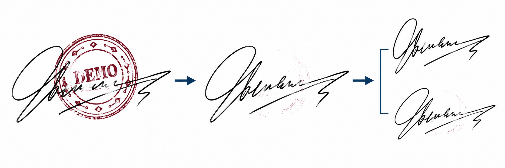
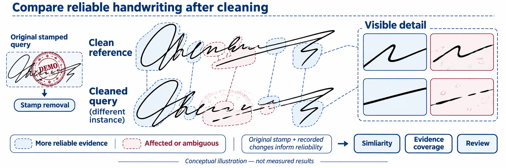
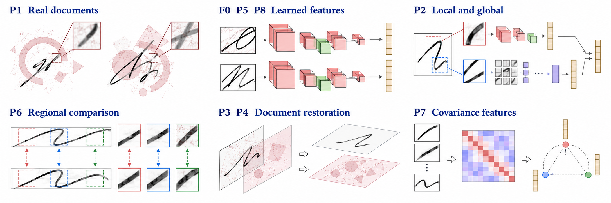
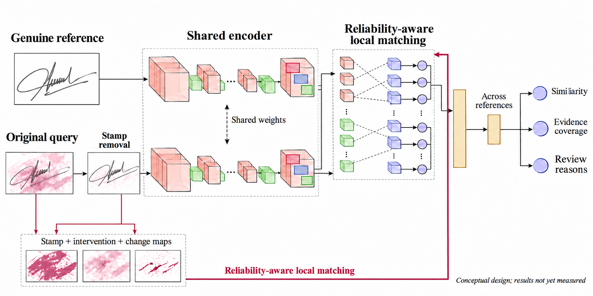
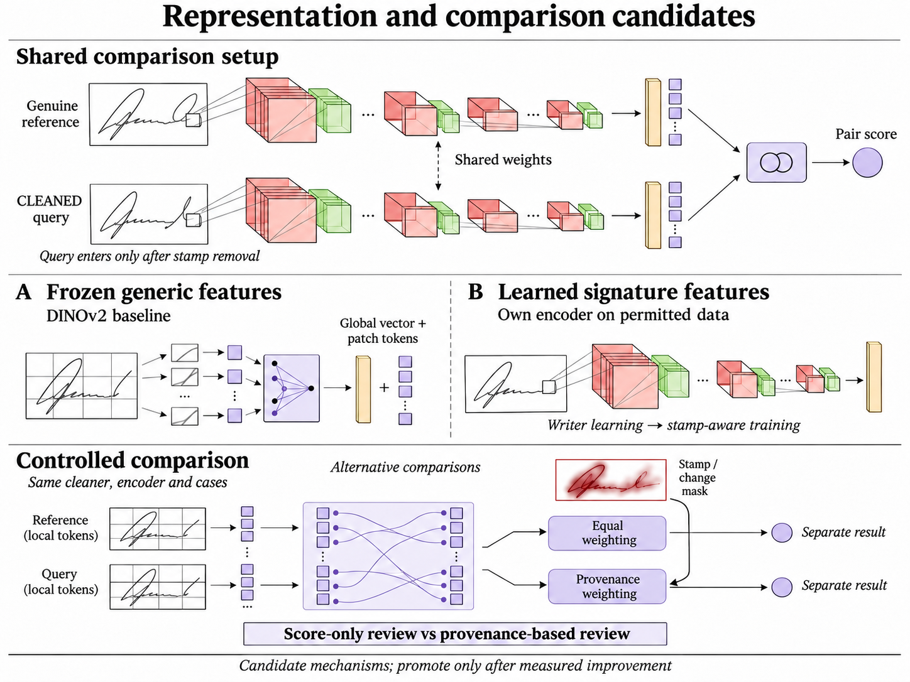

# Occlusion-Aware Signature Verification

Verification of handwritten signatures obscured by stamps, with mandatory stamp removal and provenance-aware local comparison.

**Status — 12 November 2026:** two research reviews are complete. The cleaning/provenance milestones M1a/M1a.1 and the M1b cleaner comparison are implemented. On synthetic data the experimental optical-density cleaner changed less handwriting than the colour baseline, except where a large black mark touches same-colour handwriting: both cleaners fail there and the new one fails worse, so the baseline stays the default; neither removes same-colour stamps. The first part of M2a adds a reference/query comparison pipeline: local case manifests with file hashes, EXIF-aware normalisation that transforms every mask with the image, reference enrolment with descriptive checks, and an unvalidated classical baseline (gradient-orientation histograms) that reports per-reference distances only after the query has passed through the cleaner; when stamp-affected regions are excluded, every gradient whose computation touches them is dropped as well, for the query and the references alike. It gives no genuine/forged verdict and no score for the customer; it is the floor that a pretrained encoder must beat later. 558 tests pass and two known limitations are recorded as expected failures, all on fictional synthetic data; no physical stamps or real scans have been tested. Next: a pretrained-encoder adapter for M2a, subject to approval of its dependencies and weights. The project combines an early local prototype for document review with a longer-term deep-learning research programme. No verifier accuracy, trained model or real-data runtime result is claimed yet.

[Living build plan](BUILD_PLAN.md) · [Research review](docs/research/SECOND_REVIEW.md) · [Development progress](#development-progress-and-evidence) · [Literature](literature/START_HERE.md)

## Abstract

This project investigates verification of handwritten signatures partly obscured by document stamps. Every query passes through stamp removal before comparison with genuine references, while the original and every cleaning intervention remain available for inspection. The central question is whether local matching informed by stamp and cleaning provenance improves verification over global and equal-weight local comparison. A second hypothesis tests whether that provenance helps identify unreliable comparisons. Development begins with a conservative cleaner and frozen-feature baselines, then advances to learned signature representations and stamp-aware training where experiments justify them. The intended outcome is a useful local review tool backed by reproducible experiments on unseen writers, stamps and physical scans.



*Figure 1. A stamped query is cleaned, then compared with a separate genuine reference.*

## Background and practical problem

Despite the adoption of cryptographic digital signatures in electronic workflows, handwritten signatures remain in use in banking, business contracts and document administration [1](#ref-1), [3](#ref-3). Offline verification uses a scanned or photographed image. It lacks the timing, pressure and pen movement available during online handwriting capture [2](#ref-2). Genuine signatures naturally vary, while a skilled imitation can closely resemble a reference. The task is therefore to distinguish acceptable personal variation from evidence of forgery, rather than demand a pixel-perfect match.

Stamp overlap adds a second difficulty: stamp ink can hide distinctive strokes and introduce patterns that a verifier mistakes for handwriting [1](#ref-1). Cleaning can help, but may also remove genuine strokes or generate plausible replacements. An attractive restored image does not establish that the underlying identity evidence has survived. The intended workflow uses clean genuine references and stamped queries; actual reference availability will be confirmed before a company pilot.

## Questions guiding development

### Main question · Reliable local evidence (H1)

**Does reliability-aware local matching reduce false acceptance compared with global and equal-weight local comparison of cleaned signatures, at matched usable evidence?**

Keep the cleaner, encoder and cases fixed. Change only the comparison mechanism and reliability weighting, using the original stamp estimate, intervention footprint, actual changes and ambiguous areas. Compare false acceptance at a fixed validation-selected false-rejection rate, with uncertainty estimated by writer. Local matching must account for signature variation rather than assume that fixed windows contain corresponding strokes. Less evidence must remain visible as a reason for review.



*Figure 2. Conceptual comparison of local handwriting after mandatory cleaning. Reference and query are different signing instances; highlights illustrate reliability, not measured weights or results.*

### Secondary question 1 · Review from cleaning provenance (H2)

**Can cleaning provenance identify unreliable comparisons better than a score-only review rule?**

Hold the comparator and cases fixed, then compare review policies at the same review rate. Report errors on retained cases alongside evidence coverage. Similarity, available evidence and reasons for review remain separate quantities; a favourable score must not conceal missing handwriting.

### Secondary question 2 · Stamp removal and preservation

**Which removal strategy reduces stamp interference while best preserving identity-bearing handwriting across different ink and scan conditions?**

Start with colour separation without inpainting. Deletion can still erase distinguishing strokes, and black or same-colour stamps can be invisible to colour-based detection. Compare cleaners using paired synthetic and physical examples and a fixed verifier. Record residual stamp ink, handwriting loss, missed failures and downstream errors. The uncleaned-query evaluation control remains pending owner approval; it is not a product bypass.

### Secondary question 3 · Learning and transfer

**When do a learned comparator, signature-domain encoder and stamp-aware training improve over frozen generic features on unseen writers and stamps?**

Progress one learning step at a time using permitted data. Hold out writers, source documents and stamp designs, then investigate transfer from synthetic overlays to physical scans. Separate genuine comparisons, random impostors and skilled forgeries where labels permit. Genuine-only data cannot establish skilled-forgery rejection.

### Secondary question 4 · Complexity and practical value

**Which increases in model and pipeline complexity justify their computational cost and reviewer workload?**

Measure errors, review coverage, latency and memory under stated conditions. Add learned segmentation or an occlusion-aware verifier to address a measured failure, rather than to make the architecture larger. The early local prototype does not wait for those research extensions. H1/H2 remain hypotheses; benefit and novelty are not established.

## Related work

### Real document verification

Engin et al. [1](#ref-1) study the directly relevant setting of clean reference signatures and occluded queries from real banking documents. Their pipeline combines CycleGAN stamp cleaning with CNN representations and cosine similarity. Cleaning improves verification in their experiments, but the human comparison shows that the task remains difficult. This motivates evaluating verification decisions, rather than judging cleaning by appearance alone.

### Feature learning and architectures

Hafemann et al. [2](#ref-2) learn shared CNN features and use a separate support vector machine (SVM) for each enrolled writer. Their work distinguishes a transferable representation from the final decision method. Xiao and Wu [3](#ref-3) combine a Siamese comparison setup with spatial transformation and focal loss. Zheng et al. [4](#ref-4) combine convolutional and transformer branches in HTCSigNet to represent local handwriting details and broader spatial relationships. These papers motivate architecture and training alternatives; their evaluations do not establish robustness to stamps.

### Regional and alternative representations

Liu et al. [7](#ref-7) compare corresponding signature regions using a shared metric-learning network and fuse regional scores by averaging. This provides the closest starting point for testing whether reliable visible regions deserve different weights. Giazitzis and Zois [8](#ref-8) offer a different representation based on covariance matrices and Riemannian metric learning. CCASigNet [9](#ref-9) uses correlation-based pair learning before writer-dependent classification. These alternatives show that representation, training objective and decision rule can be studied separately.

### Restoration and preservation of evidence

For restoration, Lee et al. [5](#ref-5) investigate physical versus synthetic stamp data using a diffusion model. Their EA-RMSE evaluation distinguishes residual interference from missing content. SERGAN [6](#ref-6) jointly extracts stamps and cleans documents through a double-cycle GAN. Neither study establishes preservation of writer identity in signatures. Together, the literature supports testing a visibility-aware verifier against controlled alternatives. Whether this particular adaptation improves forgery rejection remains an open question; the reviewed papers alone do not establish its novelty.



*Figure 3. Conceptual overview of the nine reviewed papers. The map does not imply that all architectures are combined.*

## Required stamp removal and reliability estimation

Preserve the original query and estimate its stamp interference. Every query then passes through stamp removal before identity comparison; a genuinely clean input may produce a measured no-op. Locating stamp ink, recording the cleaner's intervention, and estimating usable handwriting remain distinct operations. Originals are retained for provenance and human inspection.

### Estimate stamp interference and cleaning provenance

Begin with a colour-based estimator where stamp and pen inks differ. Preserve the estimated stamp support, intervention footprint, actual pixel changes, ambiguous areas and remaining handwriting support. Empty background does not count as reliable handwriting. A no-op is reported as **"no stamp detected"**, not proof that the image is clean. A reviewer may optionally indicate a stamp region when colour cannot reveal it.

### Remove stamps before verification

The initial cleaner removes only separable stamp pixels and never draws hidden strokes. It can still damage handwriting, so its output is evaluated by preservation diagnostics and downstream comparison, not visual appeal alone. Overlap that cannot be separated remains uncertain. Optical-density separation, recurring-stamp templates and learned segmentation are later candidates if measured failures justify them. Generative restoration is deferred; claimed-writer references never reconstruct the query.

## Proposed verification system

A shared encoder represents genuine references and the cleaned query. Start with a classical descriptor floor and frozen generic features; DINOv2 global and patch features are a candidate baseline, not an established signature verifier. References and queries use consistent normalisation, with masks transformed identically. Genuine references enter comparison only, never cleaning or reconstruction.



*Figure 4. Selected system concept. The original query cannot bypass cleaning. Feature stacks and matching elements are illustrative; no accuracy or calibrated confidence is implied.*

Compare global scoring, equal-weight local matching and provenance-aware local matching under the same protocol. Aggregate over genuine references and show their own variation as context. An identity-comparison score appears in the reviewer tool only after a benchmark gate against the classical baseline, including skilled forgeries where permitted data are available. If that gate fails, the first delivery remains an evidence workbench while the comparator is improved. An uncalibrated score is not an authenticity probability.

## Architecture candidates and comparison design

The initial representation is frozen and generic; the research route adds a small comparator, an own-trained signature encoder and stamp-aware training. Signature-specific features and learned local mechanisms are candidates to measure rather than promised winners. Published SigNet weights remain a permission-dependent research reference. Dataset access, checkpoint permissions and intended use are checked separately.



*Figure 5. Representation and comparison candidates in a common paired setup. The diagram shows alternatives and staged learning, not an ensemble that must combine every component or measured similarity values.*

Fine-grained matching can also make a forgery appear similar by pairing the wrong strokes. Spatial consistency, usable evidence and failure cases therefore matter alongside aggregate errors. Keep the cleaner, encoder and cases fixed when testing weighting; keep the review workload fixed when testing provenance-based review. Select learned additions on development and validation data before final evaluation.

## Data and training

The study needs permitted signatures and, for skilled-forgery evaluation, documented human imitations. The second review identifies a CC BY 4.0 genuine-signature set as a candidate for own-encoder training; its quality still needs inspection, and it supplies no forgery labels. Synthetic stamp overlays are added under controlled conditions. CEDAR is a provisional small feasibility benchmark [10](#ref-10). Larger development candidates include BHSig260 and GPDS Synthetic, subject to verification of original access conditions, labels and suitability. GPDS Synthetic requires a research agreement [11](#ref-11); its generated signatures and forgeries must be distinguished from human handwriting and skilled imitations. Research access will not be assumed to permit commercial use or redistribution.

### Separate writers and stamp designs

Writers will be separated into training, validation and test groups before constructing pairs or augmentations. Stamp templates will also be held out. The same source queries, reference sets and stamp instances will be used across methods, with stamp distributions balanced between genuine and forged queries. The main enrollment setting will use three clean references; one and five references will be tested where supported. Query images will never serve as their own references.

### Compare training conditions

Training will compare clean no-op controls with matched stamp augmentation followed by the selected cleaner. A further candidate is pairwise learning that brings clean references and cleaned genuine queries closer while retaining separation from forgeries. Stamp color, opacity, placement and blur vary. Evaluation distinguishes physical stamps from digital overlays and measures overlap with original signature foreground where ground truth is available, rather than simply counting stamped background area.

## Controlled method comparisons

| Method | Purpose |
| --- | --- |
| Stamp removal + classical descriptor | Establish a simple comparison floor. |
| Same cleaner + global frozen features | Test whether a generic representation adds useful identity signal. |
| Same cleaner/encoder + local equal weighting | Isolate local matching from reliability weighting. |
| Same cleaner/encoder + provenance weighting | Test H1 at matched usable evidence. |
| Same comparator + score-only versus provenance-based review | Test H2 at the same review rate. |
| Alternative cleaner + fixed verifier | Measure cleaning benefit, handwriting damage and runtime. |
| Learned comparator / own encoder / stamp-aware training | Test one learning increment at a time. |

Known synthetic masks provide oracle-versus-predicted diagnostics, never deployment inputs or a guaranteed accuracy upper bound. Keep reference enrolment, model fitting, threshold selection and final testing separate. Negative and inconclusive results remain part of the research record.

## Evaluation and human comparison

### Verification errors and operating threshold

The primary outcome will be genuine-signature rejection at a threshold selected on validation data to meet a provisional false-acceptance target. A 1% target will be considered only if the available independent writers and forgeries support it; it is not a claim of operational safety. Each system’s threshold will be fixed before testing. Achieved test false-acceptance rate (FAR) and false-rejection rate (FRR) will be reported together, with writer-level uncertainty. Skilled forgeries and ordinary other-writer impostors will be reported separately.

### Complexity and referral to human review

Supporting results will include equal error rate (EER), error curves, stamp-severity breakdowns, reference-count sensitivity, latency and memory on stated hardware. Architecture comparisons will document pretraining, parameter counts and tuning budgets. Reliability weighting will be compared with equal averaging using the same encoder and local matcher. Any abstention rule will be selected on validation data; its coverage and errors will be reported together, including comparisons at a similar review workload.

### Optional human comparison

If a human comparison is run after the practical baseline, reviewers and the frozen model will receive the same unseen queries and references. Record reviewer experience, response time and permission to abstain. Compare errors on paired cases and distinguish ordinary reviewers from forensic experts. An additional condition may test model assistance. Final cases are not reused for tuning; human superiority is not a promised outcome or a prerequisite for the first prototype.

## Customer pilot and limitations

The cousin supports the project and will supply both full documents and cropped signatures. The initial sample has not yet been received or inspected. The pilot needs confirmed writer identities, genuine references and reliable authenticity labels. Keep final company evaluation separate from public development data. If only genuine queries are available, measure genuine rejection and workflow behavior without claiming forgery-acceptance rates. Any imitation collection must document provenance and distinguish human imitations from ordinary other-writer signatures and digital manipulations.

Heavy overlap can leave too little evidence for either a person or a model. Weighting can discard the very details that reveal imitation; predicted masks can confuse handwriting with stamps; restoration can alter identity-bearing content. Raw images will be retained, uncertain cases referred for review and restoration judged by downstream verification as well as content-preservation diagnostics.

## Planned work and progression

Work will progress through the stages below; findings from each stage will guide the next comparison.

### 1  Establish data and mandatory cleaning

Confirm data/checkpoint permissions and labels, establish grouped splits, and build an inspectable mandatory-cleaning baseline. Preserve originals, cleaned outputs and provenance maps. Start with owned fictional traces while appropriate public data are secured.

### 2  Build the shared comparison baseline

Construct controlled stamp overlays and oracle evaluation masks, then build classical and frozen-feature comparisons on cleaned inputs. Add reference enrolment, normalisation, coverage and review reasons. Benchmark on permitted data before showing an identity score. Save preprocessing, model configuration and diagnostic failures.

### 3  Compare regions using cleaning provenance

Establish equal-weight local matching after cleaning, then change only reliability weighting while retaining the cleaner, encoder and cases. Test H1 at matched usable evidence and H2 at the same review workload. Investigate where weighting helps, where it hides forgery evidence and how much unaffected handwriting is needed.

### 4  Compare justified increases in complexity

Add a small learned comparator, an own-trained signature encoder and stamp-aware training one at a time. Promote learned segmentation if colour cleaning fails on real stamps. Retain additions that improve the error–speed tradeoff or address a clear failure; learned occlusion-aware verification remains conditional on the preceding experiments.

### 5  Freeze the full pipeline and evaluate transfer

Select thresholds and review rules using validation data, then freeze the entire cleaning-and-verification pipeline. Run held-out public and company evaluation where appropriate labels exist. Keep any later company adaptation separate from the final test group.

### 6  Deliver the local tool and portfolio evidence

Document failures, uncertainty and resource requirements. Deliver a local review prototype with reproducible experiment definitions and measured comparisons. Prepare a portfolio demonstration, architecture/data/model documentation and a short video using fictional or redistributable examples.

## References

The nine reviewed papers retain their reading IDs below. The two dataset access pages are listed separately after the papers.

### Reviewed papers

<a id="ref-1"></a>

P1  [1]  Engin, D., Kantarci, A., Arslan, S. and Ekenel, H. K. (2020). Offline Signature Verification on Real-World Documents. IEEE/CVF CVPR Workshops.

https://doi.org/10.1109/CVPRW50498.2020.00412

<a id="ref-2"></a>

F0  [2]  Hafemann, L. G., Sabourin, R. and Oliveira, L. S. (2017). Learning features for offline handwritten signature verification using deep convolutional neural networks. Pattern Recognition.

https://doi.org/10.1016/j.patcog.2017.05.012

<a id="ref-3"></a>

P5  [3]  Xiao, W. and Wu, H. (2025). Learning features for offline handwritten signature verification using spatial transformer network. Scientific Reports.

https://doi.org/10.1038/s41598-025-92704-3

<a id="ref-4"></a>

P2  [4]  Zheng, L., Wu, D., Xu, S. and Zheng, Y. (2025). HTCSigNet: A Hybrid Transformer and Convolution Signature Network for offline signature verification. Pattern Recognition.

https://doi.org/10.1016/j.patcog.2024.111146

<a id="ref-5"></a>

P3  [5]  Lee, S., Lee, N., Baek, J., Min, H., Choi, S. and Hwang, S. (2026). Stamp removal from real documents: A diffusion-based approach with EA-RMSE evaluation. Array.

https://doi.org/10.1016/j.array.2026.100855

<a id="ref-6"></a>

P4  [6]  Cui, G., Yang, C. and Guo, J. (2024). Generative adversarial networks for rubber stamp extraction and removal. Digital Signal Processing.

https://doi.org/10.1016/j.dsp.2023.104358

<a id="ref-7"></a>

P6  [7]  Liu, L., Huang, L., Yin, F. and Chen, Y. (2021). Offline signature verification using a region based deep metric learning network. Pattern Recognition.

https://doi.org/10.1016/j.patcog.2021.108009

<a id="ref-8"></a>

P7  [8]  Giazitzis, A. and Zois, E. N. (2025). Metric meta-learning and intrinsic Riemannian embedding for writer independent offline signature verification. Expert Systems with Applications.

https://doi.org/10.1016/j.eswa.2024.125470

<a id="ref-9"></a>

P8  [9]  Zheng, L., Zhao, X., Xu, S., Ren, Y. and Zheng, Y. (2025). Learning discriminative representations by a Canonical Correlation Analysis-based Siamese Network for offline signature verification. Engineering Applications of Artificial Intelligence.

https://doi.org/10.1016/j.engappai.2024.109640

### Dataset access sources

<a id="ref-10"></a>

[10]  University at Buffalo CEDAR. Published signature dataset and publications. Access page consulted 29 October 2026.

https://cedar.buffalo.edu/NIJ/publications.html

<a id="ref-11"></a>

[11]  Universidad de Las Palmas de Gran Canaria GPDS. Toolbox and Databases. Access conditions consulted 29 October 2026.

https://gpds.ulpgc.es/downloadnew/download.htm


## Development roadmap

**Selected path (second review, 11 November 2026).** The first prototype starts with a conservative, inspectable pipeline; implementation has begun, but milestone completion is not yet verified:

- a classical colour-separation stamp cleaner that never inpaints, records every change, and reports "no stamp detected" rather than "clean", because colour cannot reveal a black or same-ink stamp;
- comparison built from components with explicit permissive terms (generic pretrained patch features first), with the score shown to a reviewer only if it passes a benchmark gate against a classical baseline;
- similarity, evidence coverage and the review rule kept as three separate outputs, so that less usable evidence leads to review and never to more confidence.

This replaces two choices of the [initial review](docs/research/INITIAL_REVIEW.md): frozen SigNet features [2](#ref-2) are now a research benchmark reference only, because their published weights were trained on data restricted to non-commercial use, and fixed window scoring is dropped in favour of local patch matching. Later research milestones test two hypotheses (reliability-aware local comparison; provenance-based review) and add training only where a measured failure justifies it. Reasons, alternatives and sources are in the [second review](docs/research/SECOND_REVIEW.md).

Milestones, permissions, the evaluation protocol and stop criteria are in the [living build plan](BUILD_PLAN.md). The current task is a tested cleaning/provenance command on synthetic fixtures (M1a); its completion remains unverified. The [older detailed plan](docs/superpowers/plans/2026-11-10-customer-verification.md) is context, not a requirement to implement every experiment. See [starting instructions](docs/GETTING_STARTED.md).

## Development progress and evidence

| Checkpoint | Current state | Evidence |
|---|---|---|
| Literature foundation | Study material prepared | [Nine-paper matrix](literature/literature_matrix.csv), [notes](literature/notes/README.md) and [glossary](literature/notes/GLOSSARY.md) |
| Prototype planning | Flexible plan and coordination instructions prepared | [Build plan](BUILD_PLAN.md) and [Claude workflow](docs/CLAUDE_WORKFLOW.md) |
| Architecture/feasibility review | Completed 11 November 2026 (planning only, nothing measured) | [Initial review](docs/research/INITIAL_REVIEW.md) |
| Second review and full roadmap | Completed 11 November 2026 (planning only, nothing measured) | [Second review with evidence register](docs/research/SECOND_REVIEW.md); roadmap in the [build plan](BUILD_PLAN.md) |
| First cleaning implementation (M1a) | In progress; completion and checks not yet verified | No accuracy or runtime claim is made |
| Working comparison prototype | Planned | No verifier performance result is claimed |

Each meaningful milestone will document the practical problem solved, implementation decisions, reproducible checks and remaining limitations, with shareable visual examples or a demonstration where useful. Measured results will include their evaluation conditions. [Session reports](docs/SESSION_LOG.md) preserve the development record; this public overview separates intended features from implemented and validated work.

## Literature and project structure

- [Paper index and source links](literature/papers/README.md)
- [Reading notes](literature/notes/README.md)
- [Glossary](literature/notes/GLOSSARY.md)
- [Literature matrix](literature/literature_matrix.csv)
- [October academic preparation record](PLAN.md)
- [Historical proposal files](proposal/README.md)

```text
docs/           Current implementation design, plan and starting guide
literature/     Nine-paper study, notes, glossary and evidence matrix
proposal/       Historical bilingual proposal and original illustrations
data/           Public/synthetic guidance; company inputs stay local
src/            Planned data, cleaning, verification and evaluation modules
experiments/    Configuration and result scaffolding
models/         Local model storage guidance
tests/          Validation scaffolding
```

Folder scaffolding is not implemented functionality. Company signatures, identifying reference embeddings and private model artifacts are excluded from public sharing. The portfolio demonstration will use fictional or otherwise shareable examples. Publisher PDFs remain local where redistribution permission is unverified; the paper index provides source links.
