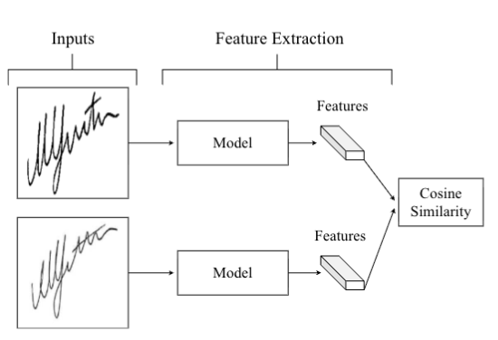

# 01 / P1 — Offline Signature Verification on Real-World Documents

**Reading day:** 17 October 2026 · Engin et al. (2020) · DOI: 10.1109/CVPRW50498.2020.00412  
**Paper:** [local PDF](../papers/01-P1-real-world-verification.pdf). All page numbers below are 1-based PDF viewer pages.  
**Personal progress:** full paper read, explicitly reported on October 17; discussed and explained back. Architecture details remain a learning topic. This note consolidates the reader's reflections and assistant explanations; the daily checkbox is unchanged.

## What the paper showed

- **Problem (pp. 1–2):** clean bank enrollment signatures must be compared with signatures on real transaction documents containing stamps and other interference. Genuine signatures vary over time; three references collected together may miss that variation.
- **Writer separation (p. 5):** representation learning uses 109 writers; verification uses 178 different writers. This supports writer-independent testing. The representation dataset itself is randomly split 70/15/15; do not confuse that internal split with the held-out verification writers.
- **Method (pp. 3–4):** CycleGAN cleaning → CNN representation → cosine similarity → global threshold. VGG-16 and ResNet-50 start from ImageNet-pretrained weights and are fine-tuned separately with raw, cleaned or inverse images. Four noise-specific datasets describe earlier work, not four cleaners developed here.
- **Controls and result (pp. 5–7, Tables 1–2):** five setups compare unstamped/stamped queries and cleaning one/both sides. For the raw-trained VGG-16 column, global EER is 18% for unstamped queries, 33% for stamped queries and 23% after cleaning stamped queries. These use the bank verification set and pairwise comparisons; they are not skilled-forgery performance guarantees. Declarations contain three references, but this is not an evaluation of a three-reference fusion rule. Tobacco-800 supplies a separate real-document evaluation; inversion has little effect in these experiments.
- **Human comparison (pp. 7–8, Table 3):** on 360 selected pairs, human majority-vote accuracy is 91.66%, versus 76.38% for VGG-16 cleaned: a 15.28 percentage-point gap. Model accuracy uses an EER-derived threshold on that subset. This is a specific comparison, not a universal human/model ranking.

## Concepts to remember

- **Verification:** does a query match the claimed writer? Identification instead asks whose signature it is.
- **Training / enrollment / testing:** learn shared features / collect a new writer's references / compare new queries. Writer-independent models can use references from unseen writers without retraining; accuracy still needs testing. Writer-dependent decisions fit a component per writer. Shared features and writer-dependent classifiers can coexist.
- **Representation:** a learned numerical vector, not a probability. CNN filters combine edges and stroke fragments into more complex features. VGG-16 stacks layers; ResNet-50 uses shortcut connections. Architecture = network design; pretrained weights = prior learning; fine-tuning = adapting those weights to signatures.
- **CycleGAN (pp. 3–4):** unpaired stamped pile X and clean pile Y; no exact before/after pairs required. G maps X→Y; F maps Y→X. Discriminators encourage realistic destination images. Cycle loss penalizes pixel differences in F(G(x))≈x and G(F(y))≈y; λ weights that constraint. F is a learned reverse mapping, not an exact mathematical inverse. These are two directions, not two alternative cleaning versions.
- **Decision:** cosine similarity compares vector directions. A threshold converts the score into accept/reject. Stricter thresholds generally reduce false acceptance while increasing false rejection. EER balances those rates; ROC shows the tradeoff across thresholds. Neither establishes a safe deployment threshold by itself.
- **Threat model:** ordinary different-writer comparisons and skilled imitations are different tests. HOG/LBP are handcrafted descriptors; SVM is a classifier.

## Main caveat and thesis relevance — our interpretation

A distinctive signature stroke is evidence, not noise. A cleaner may erase or invent strokes even when its output looks convincing; cycle consistency does not guarantee identity preservation. Judge cleaning by downstream verification as well as image quality. Proposed experiment: compare the same verifier on stamped queries with no cleaning, masking and restoration, using fixed writer splits and a validation-selected threshold. Matching human performance remains an ambition to test, not an established outcome; newer architectures do not guarantee it.

## Working problem paragraph — assistant draft for personal revision (150 words)

Offline signature verification on real documents differs from verification on clean benchmark images. A reference signature may be clean, while a transaction signature is overlapped by a stamp, text or scanning artifacts. Genuine signatures vary naturally, so visual differences do not necessarily indicate an impostor. Engin and colleagues study this setting using writer-disjoint representation-learning and verification groups. Their CycleGAN cleaning stage reduces the degradation caused by stamps, but the reported verification errors and human comparison leave substantial room for improvement. Cleaning also raises an important question: does it preserve the strokes needed to distinguish writers, rather than merely produce a cleaner image? This thesis could investigate how stamp occlusion and its treatment affect verification against clean references. A feasible evaluation would compare direct verification, masking and restoration under controlled conditions, with held-out writers and a fixed threshold policy. Human assistance is an intended application; improved safety must be measured explicitly.

**Open question:** can we suppress stamp interference without losing identity-bearing strokes?  
**Next:** October 18 — selective F0 reading, then P5; focus on shared features versus writer-specific decisions and Siamese comparison.

## Pipeline figure — confirmed October 17

**Source:** P1, PDF p. 4, Figure 3; supplied by the reader. The reader confirmed this as the pipeline sketch discussed in the session. Both branches use the same trained feature extractor. Cleaning, when applied, precedes feature extraction; a global threshold follows cosine similarity to produce the match/non-match decision. The figure itself shows the feature-extraction and comparison stages.

**Problem paragraph clarification:** the working paragraph above summarizes the practical problem, why it is difficult, what P1 establishes and what remains to investigate. It is an assistant draft for review, not a requirement to rewrite 150 words today or a claim of original thesis results.
