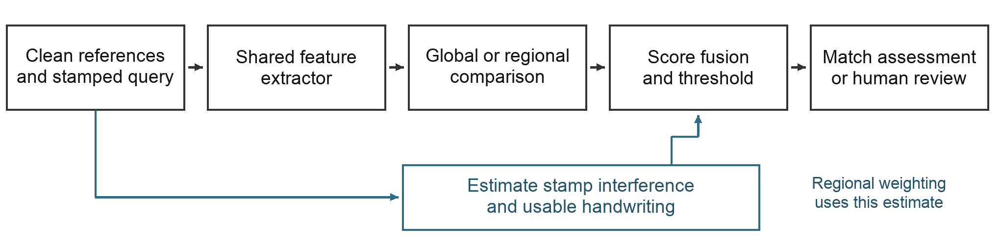
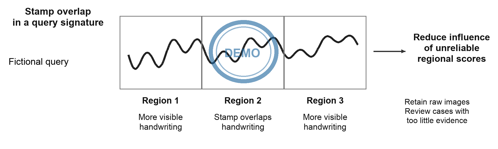

# Verification of Handwritten Signatures Obscured by Stamps

Matej Gaberc  |  Initial research proposal  |  29 October 2026

## Summary

I propose to develop and evaluate a system for comparing stamp-obscured handwritten signatures with genuine reference signatures. The central idea is to compare local regions and give more weight to regions containing usable handwriting. The study will compare this approach with whole-image verification, ordinary regional averaging and, if feasible, restoration before verification. A bounded comparison of feature extractors and training strategies will establish whether greater complexity improves verification enough to justify its computational cost. The practical outcome will be a prototype for reviewing real documents, supported by measured error rates, processing times and clear limits on when human review is needed.

## Background and practical problem

Despite the adoption of cryptographic digital signatures in electronic workflows, handwritten signatures remain in use in banking, business contracts and document administration [1, 3]. Offline verification uses a scanned or photographed image. It lacks the timing, pressure and pen movement available during online handwriting capture [2]. Genuine signatures naturally vary, while a skilled imitation can closely resemble a reference. The task is therefore to distinguish acceptable personal variation from evidence of forgery, rather than demand a pixel-perfect match.

Stamp overlap adds a second difficulty: stamp ink can hide distinctive strokes and introduce patterns that a verifier mistakes for handwriting [1]. Cleaning can help, but may also remove genuine strokes or generate plausible replacements. An attractive restored image does not establish that the underlying identity evidence has survived. The intended workflow uses clean genuine references and stamped queries; actual reference availability will be confirmed before a company pilot.

## Research questions

Can visibility-aware regional comparison improve verification of stamped signatures while maintaining reliable rejection of forgeries?

- How much does increasing model and pipeline complexity improve verification performance relative to its computational cost?

- Which strategy performs best under different stamp conditions: direct verification, visibility-aware comparison or restoration followed by verification?

- How do training data and clean–stamped training strategies affect generalization to unseen writers, stamp designs and real documents?

The study will also compare the selected model with human reviewers on a held-out subset, subject to participant availability and the required approvals. Matching or exceeding reviewer performance is an objective to investigate, rather than an assumed outcome.

## Related work

Engin et al. [1] study the directly relevant setting of clean reference signatures and occluded queries from real banking documents. Their pipeline combines CycleGAN stamp cleaning with CNN representations and cosine similarity. Cleaning improves verification in their experiments, but the human comparison shows that the task remains difficult. This motivates evaluating verification decisions, rather than judging cleaning by appearance alone.

Hafemann et al. [2] learn shared CNN features and use a separate support vector machine (SVM) for each enrolled writer. Their work distinguishes a transferable representation from the final decision method. Xiao and Wu [3] combine a Siamese comparison setup with spatial transformation and focal loss. Zheng et al. [4] combine convolutional and transformer branches in HTCSigNet to represent local handwriting details and broader spatial relationships. These papers motivate architecture and training alternatives; their evaluations do not establish robustness to stamps.

Liu et al. [7] compare corresponding signature regions using a shared metric-learning network and fuse regional scores by averaging. This provides the closest starting point for testing whether reliable visible regions deserve different weights. Giazitzis and Zois [8] offer a different representation based on covariance matrices and Riemannian metric learning. CCASigNet [9] uses correlation-based pair learning before writer-dependent classification. These alternatives show that representation, training objective and decision rule can be studied separately.

For restoration, Lee et al. [5] investigate physical versus synthetic stamp data using a diffusion model. Their EA-RMSE evaluation distinguishes residual interference from missing content. SERGAN [6] jointly extracts stamps and cleans documents through a double-cycle GAN. Neither study establishes preservation of writer identity in signatures. Together, the literature supports testing a visibility-aware verifier against controlled alternatives. Whether this particular adaptation improves forgery rejection remains an open question; the reviewed papers alone do not establish its novelty.

## Proposed verification system

The prototype will initially accept cropped reference and query signatures. A shared feature extractor will process both sides of a Siamese comparison setup. It will learn from development writers and then compare new writers without retraining the entire neural network. The main experiment will compare corresponding regions and combine their similarity scores using estimated regional reliability.

Figure 1. Proposed pipeline. The reliability estimate is used for regional weighting. Whole-image comparison, equal averaging and restoration are controlled alternatives; the diagram represents a design, not an implemented system.

A stamp estimator will initially use synthetic masks as training supervision; predicted masks will be used for the practical pipeline. Reliability must reflect usable handwriting rather than uncovered blank space. Reference scores will provisionally be averaged. The score and a validation-selected evidence rule will determine whether to issue a match assessment or request human review. Similarity scores will not be presented as calibrated authenticity probabilities.

## Data and training

The core study will use a public signature dataset containing genuine signatures and documented forgeries, with synthetic stamp overlays added under controlled conditions. CEDAR is a provisional small feasibility benchmark [10]. Larger development candidates include BHSig260 and GPDS Synthetic, subject to verification of original access conditions, labels and suitability. GPDS Synthetic requires a research agreement [11]; its generated signatures and forgeries must be distinguished from human handwriting and skilled imitations. Research access will not be assumed to permit commercial use or redistribution.

Writers will be separated into training, validation and test groups before constructing pairs or augmentations. Stamp templates will also be held out. The same source queries, reference sets and stamp instances will be used across methods, with stamp distributions balanced between genuine and forged queries. The main enrollment setting will use three clean references; one and five references will be tested where supported. Query images will never serve as their own references.

Training will compare clean-only examples with matched stamp augmentation. A further candidate is pairwise learning that brings clean and stamped genuine signatures closer while retaining separation from forgeries. Stamp colour, opacity, placement and blur will vary. Evaluation will distinguish physical stamps from digital overlays and examine increasing overlap with the original signature foreground, rather than simply counting stamped background area.

## Controlled method comparisons

| Method | Purpose |
| --- | --- |
| Whole-image comparison | Establish a simple shared CNN baseline. |
| Regional equal averaging | Measure regional comparison without visibility weighting. |
| Same regional model with weighting | Isolate the effect of the proposed reliability rule. |
| Selected architecture alternative | Compare a CNN–transformer hybrid under the same protocol. |
| Restoration before fixed verification | Optional comparison of cleaning, evidence loss and runtime. |

Figure 2. Conceptual regional weighting with a fictional handwriting trace and a demonstration stamp. Stamp overlap may reduce a region’s contribution, but can also hide evidence of forgery. No weights or performance results are asserted.

The CNN and hybrid are representative candidates, not presumed winners. A distance or personal-SVM comparator, covariance features, alignment or a different pairwise loss may be added only to address a measured limitation. Known synthetic masks will provide a diagnostic comparison with predicted masks; they are not deployable inputs or a guaranteed accuracy upper bound. Alignment errors and overlap between windows will also be examined.

## Evaluation and human comparison

The primary outcome will be genuine-signature rejection at a threshold selected on validation data to meet a provisional false-acceptance target. A 1% target will be considered only if the available independent writers and forgeries support it; it is not a claim of operational safety. Each system’s threshold will be fixed before testing. Achieved test false-acceptance rate (FAR) and false-rejection rate (FRR) will be reported together, with writer-level uncertainty. Skilled forgeries and ordinary other-writer impostors will be reported separately.

Supporting results will include equal error rate (EER), error curves, stamp-severity breakdowns, reference-count sensitivity, latency and memory on stated hardware. Architecture comparisons will document pretraining, parameter counts and tuning budgets. Reliability weighting will be compared with equal averaging using the same trained regional model. Any abstention rule will be selected on validation data; its coverage and errors will be reported so that requesting more human reviews cannot masquerade as better classification.

For the human comparison, reviewers and the frozen model will receive the same unseen queries and references. Reviewer experience, response time and permission to abstain will be recorded. Error rates will be compared on paired cases, distinguishing ordinary reviewers from forensic experts. If feasible, a further condition will test whether model assistance helps reviewers. Final test cases will not be reused to tune the system.

## Real document pilot and limitations

An optional company pilot requires authorization, confirmed writer identities, genuine references and reliable authenticity labels. It will use a frozen pipeline and remain separate from public development data. If only genuine queries are available, it can measure genuine rejection and workflow behaviour, but cannot establish forgery-acceptance rates. Any consented imitation collection will document its procedure and distinguish human imitations from random impostors or digital manipulations.

Heavy overlap can leave too little evidence for either a person or a model. Weighting can discard the very details that reveal imitation; predicted masks can confuse handwriting with stamps; restoration can alter identity-bearing content. Raw images will be retained, uncertain cases referred for review and restoration judged by downstream verification as well as content-preservation diagnostics. The expected contribution is reproducible evidence about when the proposed method helps or fails, together with a practical prototype and a justified recommendation.

## Proposed timeline after supervisor approval

| Period | Planned work |
| --- | --- |
| Weeks 1–2 | Confirm data access and labels; establish splits and whole-image baseline. |
| Weeks 3–5 | Build regional comparison, stamp estimation and weighting; run controlled tests. |
| Weeks 6–7 | Run selected architecture/training comparisons and optional restoration. |
| Weeks 8–10 | Freeze evaluation; reviewer study and available pilot; analyse and write. |

This ten-week sequence is provisional. If data or compute are limited, protect the regional weighting experiment and reduce optional comparisons. Supervisor discussion should confirm scope, the dataset and permissions, the operating metric and reviewer-study feasibility. An architecture-centred or training-centred main study remains an alternative if those constraints make it more useful. Implementation starts after approval.

## References

[1] Engin, D., Kantarci, A., Arslan, S. and Ekenel, H. K. (2020). Offline Signature Verification on Real-World Documents. IEEE/CVF CVPR Workshops. https://doi.org/10.1109/CVPRW50498.2020.00412

[2] Hafemann, L. G., Sabourin, R. and Oliveira, L. S. (2017). Learning features for offline handwritten signature verification using deep convolutional neural networks. Pattern Recognition. https://doi.org/10.1016/j.patcog.2017.05.012

[3] Xiao, W. and Wu, H. (2025). Learning features for offline handwritten signature verification using spatial transformer network. Scientific Reports. https://doi.org/10.1038/s41598-025-92704-3

[4] Zheng, L., Wu, D., Xu, S. and Zheng, Y. (2025). HTCSigNet: A Hybrid Transformer and Convolution Signature Network for offline signature verification. Pattern Recognition. https://doi.org/10.1016/j.patcog.2024.111146

[5] Lee, S., Lee, N., Baek, J., Min, H., Choi, S. and Hwang, S. (2026). Stamp removal from real documents: A diffusion-based approach with EA-RMSE evaluation. Array. https://doi.org/10.1016/j.array.2026.100855

[6] Cui, G., Yang, C. and Guo, J. (2024). Generative adversarial networks for rubber stamp extraction and removal. Digital Signal Processing. https://doi.org/10.1016/j.dsp.2023.104358

[7] Liu, L., Huang, L., Yin, F. and Chen, Y. (2021). Offline signature verification using a region based deep metric learning network. Pattern Recognition. https://doi.org/10.1016/j.patcog.2021.108009

[8] Giazitzis, A. and Zois, E. N. (2025). Metric meta-learning and intrinsic Riemannian embedding for writer independent offline signature verification. Expert Systems with Applications. https://doi.org/10.1016/j.eswa.2024.125470

[9] Zheng, L., Zhao, X., Xu, S., Ren, Y. and Zheng, Y. (2025). Learning discriminative representations by a Canonical Correlation Analysis-based Siamese Network for offline signature verification. Engineering Applications of Artificial Intelligence. https://doi.org/10.1016/j.engappai.2024.109640

[10] University at Buffalo CEDAR. Published signature dataset and publications. Access page consulted 29 October 2026. https://cedar.buffalo.edu/NIJ/publications.html

[11] Universidad de Las Palmas de Gran Canaria GPDS. Toolbox and Databases. Access conditions consulted 29 October 2026. https://gpds.ulpgc.es/downloadnew/download.htm
