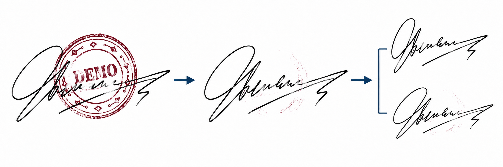
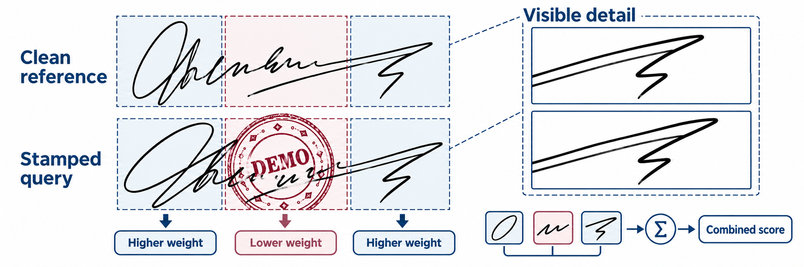
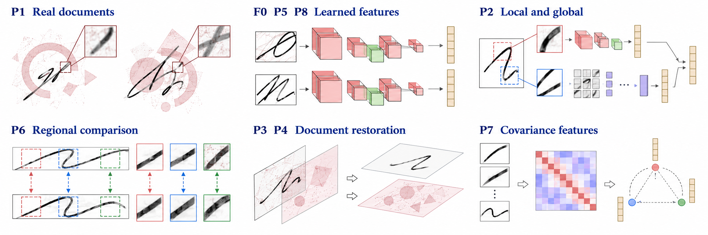
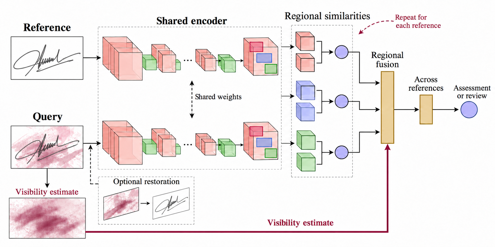
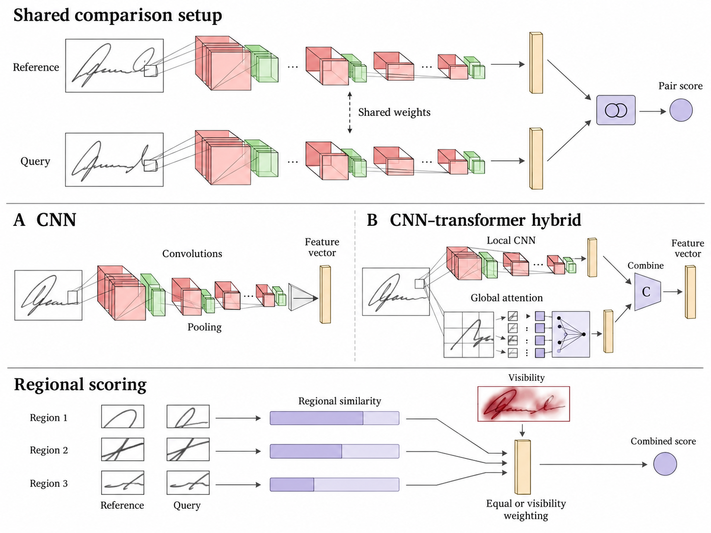

# Verification of Handwritten Signatures Obscured by Stamps

Matej Gaberc
Research proposal  |  30 October 2026

## Abstract

This proposal investigates verification of handwritten signatures partly obscured by stamps. It tests whether weighting regional comparisons by usable handwriting improves genuine-signature recognition while retaining rejection of forgeries. Whole-image scoring, ordinary regional averaging and optional restoration will provide controlled comparisons. Selected CNN and CNN–transformer candidates will examine the value of greater complexity, while clean–stamped training will test robustness to unfamiliar writers and stamps. The intended outcome is an evaluated prototype for document review, with measured errors and processing cost, an independent human comparison and a rule for referring cases with insufficient evidence.

Figure 1. Demo of a possible cleaning and reference-comparison workflow.

## Background and practical problem

Despite the adoption of cryptographic digital signatures in electronic workflows, handwritten signatures remain in use in banking, business contracts and document administration [1, 3]. Offline verification uses a scanned or photographed image. It lacks the timing, pressure and pen movement available during online handwriting capture [2]. Genuine signatures naturally vary, while a skilled imitation can closely resemble a reference. The task is therefore to distinguish acceptable personal variation from evidence of forgery, rather than demand a pixel-perfect match.

Stamp overlap adds a second difficulty: stamp ink can hide distinctive strokes and introduce patterns that a verifier mistakes for handwriting [1]. Cleaning can help, but may also remove genuine strokes or generate plausible replacements. An attractive restored image does not establish that the underlying identity evidence has survived. The intended workflow uses clean genuine references and stamped queries; actual reference availability will be confirmed before a company pilot.

## Research questions

### Main question

Can visibility-aware regional comparison improve verification of stamped signatures while maintaining reliable rejection of forgeries?

Whole-image scores can be contaminated by stamp patterns; equal regional averaging can overvalue corrupted evidence. Inspired by P6 [7], this study will estimate usable handwriting and weight regional similarities accordingly. The controlled test keeps the regional verifier fixed and checks both genuine rejection and forgery acceptance.

Figure 2. Demo of visibility-aware regional comparison, with natural variation between reference and query.

### Secondary question 1  Complexity and architecture

How much does increasing model and pipeline complexity improve verification performance relative to its computational cost?

Progress from a shared CNN to selected additions such as multi-scale features, alignment and a local/global hybrid. Measure errors, latency and model size. The architecture page explains how these choices fit the shared comparison setup.

### Secondary question 2  Stamp handling strategy

Which strategy performs best under different stamp conditions: direct verification, visibility-aware comparison or restoration followed by verification?

Test direct, visibility-aware and restoration routes on identical queries across stamp conditions. Check whether cleaning exposes useful structure or changes identity evidence, and identify when human review is preferable.

### Secondary question 3  Training and transfer

How do training data and clean–stamped training strategies affect generalization to unseen writers, stamp designs and real documents?

Compare clean-only training, stamp augmentation and selected clean–stamped pair learning. Hold out writers and stamp designs, then assess transfer to physical documents where suitable data are available.

## Related work

### Real document verification

Engin et al. [1] study the directly relevant setting of clean reference signatures and occluded queries from real banking documents. Their pipeline combines CycleGAN stamp cleaning with CNN representations and cosine similarity. Cleaning improves verification in their experiments, but the human comparison shows that the task remains difficult. This motivates evaluating verification decisions, rather than judging cleaning by appearance alone.

### Feature learning and architectures

Hafemann et al. [2] learn shared CNN features and use a separate support vector machine (SVM) for each enrolled writer. Their work distinguishes a transferable representation from the final decision method. Xiao and Wu [3] combine a Siamese comparison setup with spatial transformation and focal loss. Zheng et al. [4] combine convolutional and transformer branches in HTCSigNet to represent local handwriting details and broader spatial relationships. These papers motivate architecture and training alternatives; their evaluations do not establish robustness to stamps.

### Regional and alternative representations

Liu et al. [7] compare corresponding signature regions using a shared metric-learning network and fuse regional scores by averaging. This provides the closest starting point for testing whether reliable visible regions deserve different weights. Giazitzis and Zois [8] offer a different representation based on covariance matrices and Riemannian metric learning. CCASigNet [9] uses correlation-based pair learning before writer-dependent classification. These alternatives show that representation, training objective and decision rule can be studied separately.

### Restoration and preservation of evidence

For restoration, Lee et al. [5] investigate physical versus synthetic stamp data using a diffusion model. Their EA-RMSE evaluation distinguishes residual interference from missing content. SERGAN [6] jointly extracts stamps and cleans documents through a double-cycle GAN. Neither study establishes preservation of writer identity in signatures. Together, the literature supports testing a visibility-aware verifier against controlled alternatives. Whether this particular adaptation improves forgery rejection remains an open question; the reviewed papers alone do not establish its novelty.

Figure 3. Conceptual overview of the ideas drawn from the nine reviewed papers.

## Proposed stamp handling and removal

Assess stamp interference while preserving the original query for direct verification and review. Locating stamp ink, estimating usable handwriting and generating a cleaned image are distinct operations; removal is one route to test.

### Estimate stamp interference and usable regions

Train a stamp estimator using synthetic masks. Begin with a colour-based baseline where inks differ, then evaluate a learned estimator. Combine predicted interference with usable handwriting, so that empty background does not receive undue weight.

### Evaluate restoration before verification

Select one feasible GAN or conditional-diffusion cleaner [1, 5, 6]. Compare restored and untreated queries using a fixed verifier. With paired clean targets, inspect residual stamp ink and altered strokes alongside verification errors and runtime.

## Proposed verification system

A Siamese setup will apply a shared extractor to cropped references and queries. It will learn from development writers, then compare new writers using genuine references without retraining the entire neural network.

Figure 4. Demo of shared feature extraction, paired regional comparison, visibility-aware fusion and aggregation across references. Restoration is an optional route.

Compare whole-image scoring, equal regional averaging and reliability-weighted fusion. Provisionally average across references, then apply a validation-selected threshold and evidence rule. Return a match assessment or request review; a similarity score is not a calibrated authenticity probability.

## Architecture candidates and comparison design

Both candidates use the same reference–query setup. A CNN pools learned stroke features into a vector. The hybrid combines a convolutional local branch with a transformer branch for broader relationships, then concatenates and projects the features. These are representative candidates informed by the reviewed methods [2, 4, 7].

Figure 5. Candidate comparison setup, CNN and CNN–transformer extractors, and regional fusion. Layer stacks are illustrative; exact depth and backbone choices remain experimental.

Compare a learned pair score with a simple feature-distance rule where feasible. Select depth, training losses and other module choices using development and validation data. A personal SVM is a separate writer-dependent comparator; covariance features remain an optional alternative. This modular design is inspired by the papers rather than an exact reproduction of P6’s pair-interacting network.

## Data and training

The core study will use a public signature dataset containing genuine signatures and documented forgeries, with synthetic stamp overlays added under controlled conditions. CEDAR is a provisional small feasibility benchmark [10]. Larger development candidates include BHSig260 and GPDS Synthetic, subject to verification of original access conditions, labels and suitability. GPDS Synthetic requires a research agreement [11]; its generated signatures and forgeries must be distinguished from human handwriting and skilled imitations. Research access will not be assumed to permit commercial use or redistribution.

### Separate writers and stamp designs

Writers will be separated into training, validation and test groups before constructing pairs or augmentations. Stamp templates will also be held out. The same source queries, reference sets and stamp instances will be used across methods, with stamp distributions balanced between genuine and forged queries. The main enrollment setting will use three clean references; one and five references will be tested where supported. Query images will never serve as their own references.

### Compare training conditions

Training will compare clean-only examples with matched stamp augmentation. A further candidate is pairwise learning that brings clean and stamped genuine signatures closer while retaining separation from forgeries. Stamp colour, opacity, placement and blur will vary. Evaluation will distinguish physical stamps from digital overlays and examine increasing overlap with the original signature foreground, rather than simply counting stamped background area.

## Controlled method comparisons

| Method | Purpose |
| --- | --- |
| Whole-image comparison | Establish a simple shared CNN baseline. |
| Regional equal averaging | Measure regional comparison without visibility weighting. |
| Same regional model with weighting | Isolate the effect of the proposed reliability rule. |
| Selected architecture alternative | Compare a CNN–transformer hybrid under the same protocol. |
| Restoration before fixed verification | Optional comparison of cleaning, evidence loss and runtime. |

The CNN and hybrid are representative candidates rather than presumed winners. A distance or personal-SVM comparator, covariance features, alignment or a different pairwise loss may be added to address a measured limitation. Each addition should isolate a useful question rather than create an exhaustive combination of every architecture and loss in the literature.

For visibility weighting, known synthetic masks will provide a diagnostic comparison with predicted masks. They are not deployable inputs or a guaranteed accuracy upper bound. Alignment errors, overlapping windows and the amount of remaining handwriting will be examined. The public-data experiment remains the core study if a company pilot is unavailable.

## Evaluation and human comparison

### Verification errors and operating threshold

The primary outcome will be genuine-signature rejection at a threshold selected on validation data to meet a provisional false-acceptance target. A 1% target will be considered only if the available independent writers and forgeries support it; it is not a claim of operational safety. Each system’s threshold will be fixed before testing. Achieved test false-acceptance rate (FAR) and false-rejection rate (FRR) will be reported together, with writer-level uncertainty. Skilled forgeries and ordinary other-writer impostors will be reported separately.

### Complexity and referral to human review

Supporting results will include equal error rate (EER), error curves, stamp-severity breakdowns, reference-count sensitivity, latency and memory on stated hardware. Architecture comparisons will document pretraining, parameter counts and tuning budgets. Reliability weighting will be compared with equal averaging using the same trained regional model. Any abstention rule will be selected on validation data; its coverage and errors will be reported together, including comparisons at a similar review workload.

### Compare reviewers and the model

For the human comparison, reviewers and the frozen model will receive the same unseen queries and references. Reviewer experience, response time and permission to abstain will be recorded. Error rates will be compared on paired cases, distinguishing ordinary reviewers from forensic experts. If feasible, a further condition will test whether model assistance helps reviewers. Final test cases will not be reused to tune the system.

## Real document pilot and limitations

An optional company pilot requires authorization, confirmed writer identities, genuine references and reliable authenticity labels. It will use a frozen pipeline and remain separate from public development data. If only genuine queries are available, it can measure genuine rejection and workflow behaviour, but cannot establish forgery-acceptance rates. Any consented imitation collection will document its procedure and distinguish human imitations from random impostors or digital manipulations.

Heavy overlap can leave too little evidence for either a person or a model. Weighting can discard the very details that reveal imitation; predicted masks can confuse handwriting with stamps; restoration can alter identity-bearing content. Raw images will be retained, uncertain cases referred for review and restoration judged by downstream verification as well as content-preservation diagnostics.

## Planned work and progression

Implementation will begin after supervisor approval. Work will progress through the stages below; findings from each stage will guide the next comparison.

### 1  Establish the data and a simple baseline

Confirm dataset permissions, inspect labels and establish separate writers, reference sets and stamp templates. Implement a reproducible whole-image verifier and record its behaviour on clean and stamped queries.

### 2  Build the stamp handling stage

Construct controlled stamp overlays and their masks, then evaluate predicted interference maps. Select a feasible restoration comparison if resources allow, preserving the raw images and paired clean targets for inspection.

### 3  Test regional comparison and visibility weighting

Establish ordinary regional averaging, then change the fusion rule while retaining the same regional verifier. Investigate where weighting improves decisions, where it hides forgery evidence and how little visible handwriting the model can use reliably.

### 4  Compare justified increases in complexity

Evaluate selected feature extractors and training strategies using matched data and a stated tuning budget. Retain additions that improve the error–speed tradeoff or address a clear failure; reduce optional experiments if data or compute are limiting.

### 5  Freeze the system and evaluate transfer

Select thresholds and review rules using validation data, then freeze the pipeline. Run the final public test, the planned reviewer comparison and any authorized real-document pilot. Keep evaluation cases separate from further model tuning.

### 6  Analyse results and recommend a practical solution

Document failure cases, uncertainty and resource requirements. Deliver an evaluated prototype and reproducible experiment definitions, together with a recommendation for the real document workflow and a clear account of when human review remains necessary.

## Points for supervisor discussion

Confirm the central question, the dataset and permission requirements, the minimum forgery evaluation and reviewer-study feasibility. An architecture-centred or training-centred main study remains an alternative if those constraints make it more useful. The eventual architecture will be chosen from evidence; the proposal does not assume that the most complex candidate will perform best.

## References

[1] P1 — Engin, D., Kantarci, A., Arslan, S. and Ekenel, H. K. (2020). Offline Signature Verification on Real-World Documents. IEEE/CVF CVPR Workshops. https://doi.org/10.1109/CVPRW50498.2020.00412

[2] F0 — Hafemann, L. G., Sabourin, R. and Oliveira, L. S. (2017). Learning features for offline handwritten signature verification using deep convolutional neural networks. Pattern Recognition. https://doi.org/10.1016/j.patcog.2017.05.012

[3] P5 — Xiao, W. and Wu, H. (2025). Learning features for offline handwritten signature verification using spatial transformer network. Scientific Reports. https://doi.org/10.1038/s41598-025-92704-3

[4] P2 — Zheng, L., Wu, D., Xu, S. and Zheng, Y. (2025). HTCSigNet: A Hybrid Transformer and Convolution Signature Network for offline signature verification. Pattern Recognition. https://doi.org/10.1016/j.patcog.2024.111146

[5] P3 — Lee, S., Lee, N., Baek, J., Min, H., Choi, S. and Hwang, S. (2026). Stamp removal from real documents: A diffusion-based approach with EA-RMSE evaluation. Array. https://doi.org/10.1016/j.array.2026.100855

[6] P4 — Cui, G., Yang, C. and Guo, J. (2024). Generative adversarial networks for rubber stamp extraction and removal. Digital Signal Processing. https://doi.org/10.1016/j.dsp.2023.104358

[7] P6 — Liu, L., Huang, L., Yin, F. and Chen, Y. (2021). Offline signature verification using a region based deep metric learning network. Pattern Recognition. https://doi.org/10.1016/j.patcog.2021.108009

[8] P7 — Giazitzis, A. and Zois, E. N. (2025). Metric meta-learning and intrinsic Riemannian embedding for writer independent offline signature verification. Expert Systems with Applications. https://doi.org/10.1016/j.eswa.2024.125470

[9] P8 — Zheng, L., Zhao, X., Xu, S., Ren, Y. and Zheng, Y. (2025). Learning discriminative representations by a Canonical Correlation Analysis-based Siamese Network for offline signature verification. Engineering Applications of Artificial Intelligence. https://doi.org/10.1016/j.engappai.2024.109640

[10] University at Buffalo CEDAR. Published signature dataset and publications. Access page consulted 29 October 2026. https://cedar.buffalo.edu/NIJ/publications.html

[11] Universidad de Las Palmas de Gran Canaria GPDS. Toolbox and Databases. Access conditions consulted 29 October 2026. https://gpds.ulpgc.es/downloadnew/download.htm
